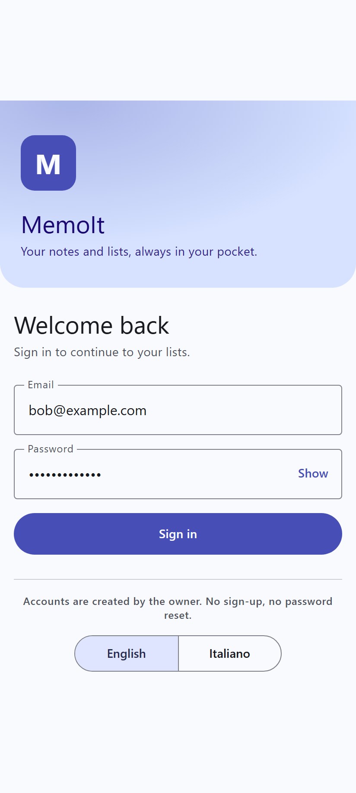
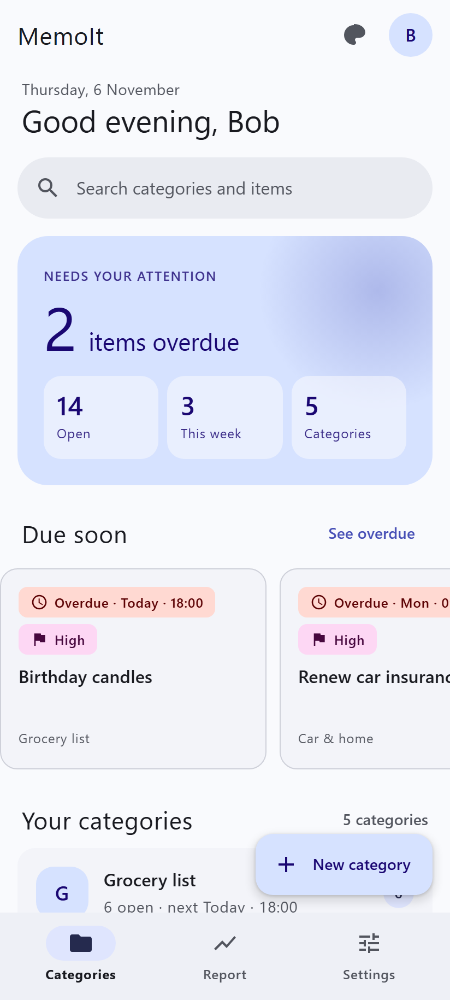
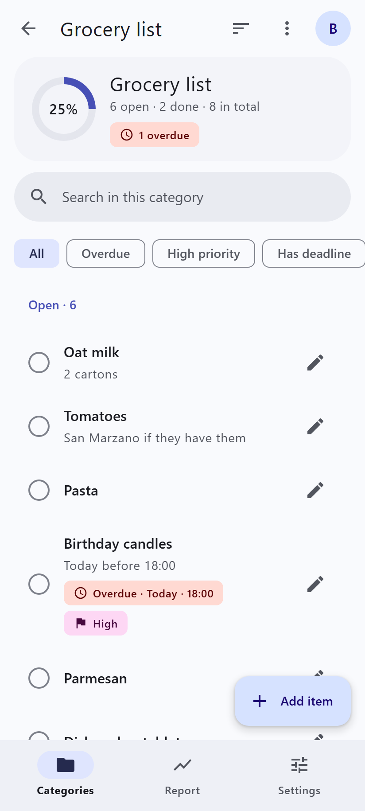
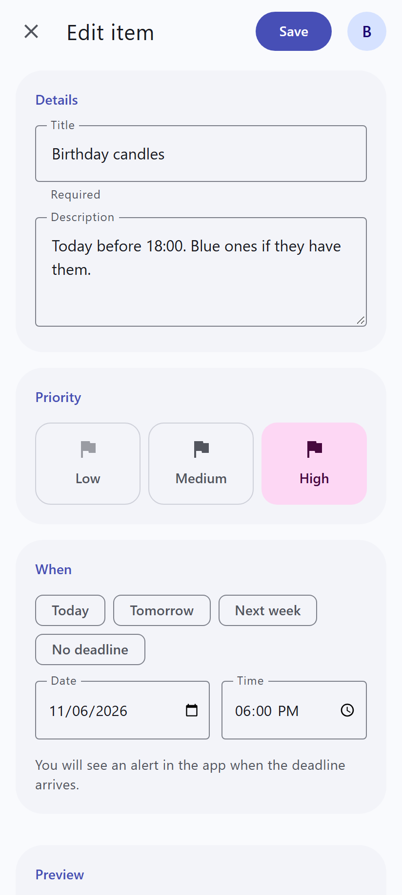
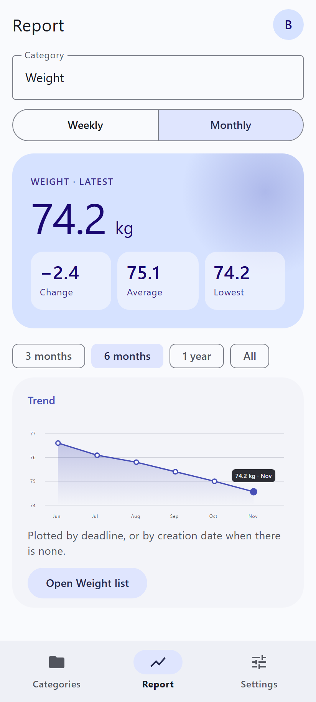
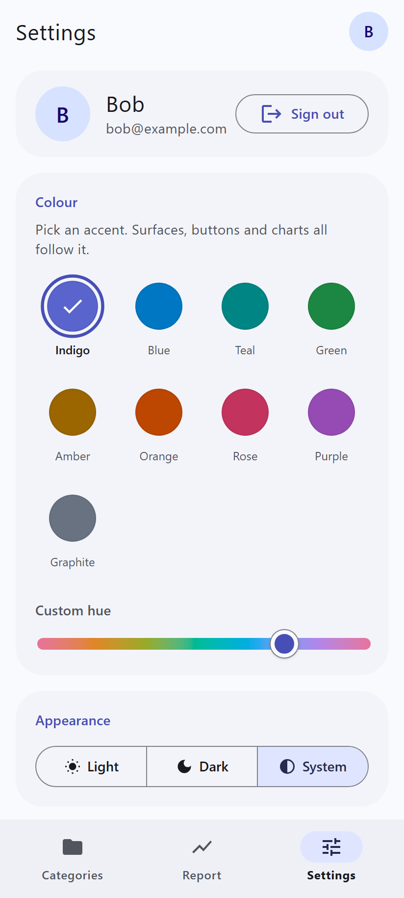
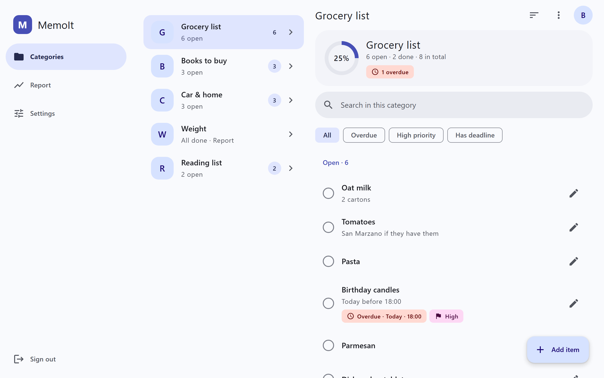
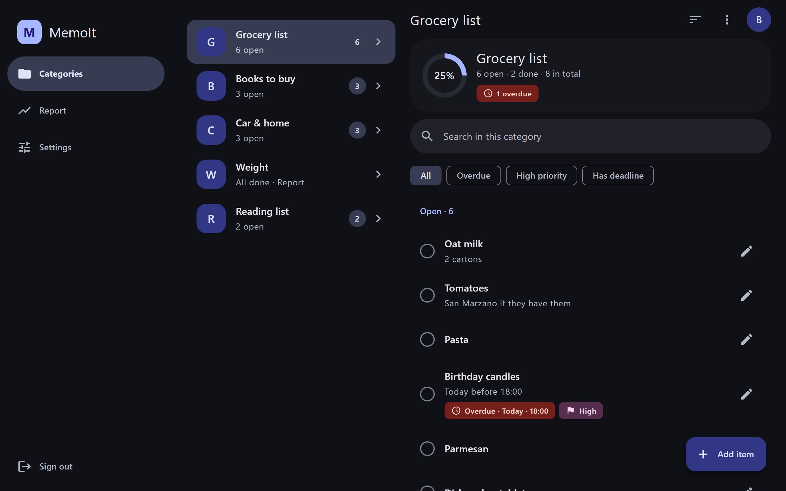
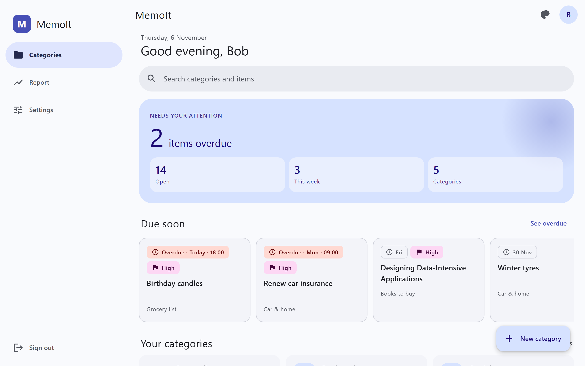

# 📝 MemoIt

**A small, private web app for notes, to-do lists and wish lists — built to be *consulted*, not just written.**

Open "Grocery list" at the supermarket and see exactly what you meant to buy. Tap an item and it's marked **Done**, and it stays that way. One tap to capture, one tap to tick off. No clutter, no custom fields, no sign-up flow.

> Built with Angular 22, Angular Material (M3), Firebase Authentication and Firestore. No server code, no Cloud Functions.

---

## ✨ What it does

- **Categories** — group your items ("Groceries", "Books to read", "Car & home"). Each category has its own *Done* wording (Bought, Read, Done…).
- **Items** — title, optional description, priority (low / medium / high), optional deadline. Tap to toggle Done, with Undo.
- **Search, filters and sorting** on every list.
- **Deadline alerts** — an in-app alert when an item's deadline arrives or has passed.
- **Reports** — mark a category as *Reportable*, attach a numeric value to its items (spending, weight, pages read…) and get a weekly/monthly chart.
- **Private by design** — every user sees only their own data, enforced by Firestore security rules (covered by a dedicated rules test suite).
- **Personal touch** — accent colours with a custom hue, light / dark / system theme, English and Italian.
- **Mobile-first**, responsive on tablet and desktop.

Accounts are created manually by the owner (there is deliberately no self-registration).

---

## 📸 Screenshots

> The images come from the navigable HTML mockups produced in the UX design phase (`_bmad-output/planning-artifacts/ux-designs/.../mockups`), which the Angular app implements screen by screen.

### Mobile

| Sign in | Categories | Items |
|:---:|:---:|:---:|
|  |  |  |

| Edit item | Report | Settings and theme |
|:---:|:---:|:---:|
|  |  |  |

### Desktop

Two-pane layout on wide screens: categories on the left, items of the selected category on the right.







---

## 🚀 Quick start (no Firebase account needed)

MemoIt runs entirely against the **Firebase Emulator Suite** in development, so you can try it locally without touching a real Firebase project. The dev environment (`src/environments/environment.ts`) already points to the emulators with a `demo-memoit` project.

### Prerequisites

- **Node.js 22+** (developed on 24) and npm
- **Java 21+** (required by the Firestore emulator)

### 1. Install

```bash
git clone <repo-url>
cd MemoIt
npm install
```

### 2. Start the emulators (terminal 1)

```bash
npm run emulators
```

This starts the Auth emulator on `127.0.0.1:9099` and Firestore on `127.0.0.1:8080`.

### 3. Create a local user

There is no sign-up screen, so create a user in the Auth emulator:

```bash
curl -X POST "http://127.0.0.1:9099/identitytoolkit.googleapis.com/v1/accounts:signUp?key=demo-api-key" \
  -H "Content-Type: application/json" \
  -d '{"email":"bob@example.com","password":"password123","displayName":"Bob"}'
```

### 4. Start the app (terminal 2)

```bash
npm start
```

Open <http://localhost:4200> and sign in with the user you just created.

> Emulator data is in memory and is wiped when you stop the emulators. The app refuses to connect to emulators unless the project id starts with `demo-`, so it can never mix emulator and real data.

---

## 🔥 Setting up your own Firebase project

To run MemoIt for real (your data, your users), you need a Firebase project.

1. **Create a project** in the [Firebase console](https://console.firebase.google.com/).
2. **Authentication** → *Sign-in method* → enable **Email/Password**. Then add your users under *Authentication → Users → Add user* (no self-sign-up).
3. **Firestore** → *Create database* (production mode; the architecture assumes the `eur3` region, but any region works).
4. **Register a web app** (*Project settings → Your apps → Web*) and copy its config.
5. **Point the CLI at your project**:
   ```bash
   npx firebase login
   npx firebase use --add      # or edit .firebaserc
   ```
6. **Create the production environment file**:
   ```bash
   cp src/environments/environment.prod.example.ts src/environments/environment.prod.ts
   ```
   then replace the `firebase` values (`apiKey`, `authDomain`, `projectId`, `appId`) with your web app config. Keep `useEmulators: false`.
7. **Deploy the security rules** (do this before storing any real data):
   ```bash
   npx firebase deploy --only firestore:rules
   ```

### Production build and deploy

```bash
npm run build:prod        # checks environment.prod.ts, then builds
npm run deploy            # lint + tests + rules tests + build + deploy rules and hosting
```

`build:prod` is guarded by `scripts/check-prod-env.mjs`: it fails if `environment.prod.ts` is missing, still has `YOUR_...` placeholders, or has `useEmulators: true`.

**GitHub Pages instead of Firebase Hosting?** The app uses hash routing, so it works on any static host. On Windows, `build-pages.bat` builds with `--base-href /memoit/` and adds the `404.html` fallback; publish the contents of `dist/memoit/browser`. Remember to add your Pages domain to *Authentication → Settings → Authorized domains*.

---

## 🧪 Scripts

| Command | What it does |
|---|---|
| `npm start` | Dev server on `localhost:4200` (uses the emulators) |
| `npm run emulators` | Auth + Firestore emulators |
| `npm test` | Unit tests (Vitest) |
| `npm run test:rules` | Firestore security-rules tests, run inside the emulator |
| `npm run test:e2e` | Playwright end-to-end and accessibility tests (starts the emulators itself) |
| `npm run lint` | ESLint, plus a check that no server code (Cloud Functions) sneaks in |
| `npm run check` | lint + unit tests + rules tests |
| `npm run build:prod` | Production build (requires `environment.prod.ts`) |
| `npm run deploy` | Full check, build and deploy |

---

## 🗂️ Project layout

```
src/app/
  core/        data backends (Firebase), stores, session and state
  domain/      pure domain logic
  features/    auth, categories, category-settings, items, item-edit, report, settings
  shared/      reusable UI
  shell/       app shell and navigation
src/environments/   environment (emulators), prod example, model
tests/rules/        Firestore security-rules tests
e2e/                Playwright journeys and accessibility checks
firestore.rules     per-user data isolation and validation
```

## 🔐 Notes on configuration and secrets

- `src/environments/environment.prod.ts` is **gitignored** and never committed; only `environment.prod.example.ts` is tracked.
- Firebase web `apiKey` values are identifiers, not secrets: access is protected by Authentication and the Firestore rules. Still, never commit service-account keys or admin credentials.

## 📄 License

Personal project. Add a license of your choice before accepting contributions.

---

## 📎 Appendix — Firebase setup, step by step

MemoIt has no server code: "the server" is managed Firebase (Authentication + Firestore + Hosting). The free **Spark** plan is enough; you do not need Blaze or Cloud Functions. Suggested names: project `memoit-app`, web app `MemoIt Web`, database `(default)`.

> Project IDs are globally unique. If `memoit-app` is taken, Firebase proposes one such as `memoit-app-a1b2c`: use that wherever `memoit-app` appears below.

The app signs in with email + password only and has **no sign-up screen**: you create the users yourself from the console (step 5).

### 1. Prerequisites (once)

1. A Google account. Node and npm are already needed for the app (`packageManager: npm@11.12.1`).
2. Run `npm install` in the project folder. The Firebase CLI (`firebase-tools`) is a dev dependency, so use `npx firebase ...`.
3. Log in with `npx firebase login` (a browser window opens). Check with `npx firebase projects:list`.

### 2. Create the project

1. Open the [Firebase console](https://console.firebase.google.com/) → **Add project** → name it `memoit-app`.
2. **Disable Google Analytics**: it is not needed and keeps the project small.
3. Optional, from the CLI: `npx firebase projects:create memoit-app --display-name "MemoIt"`.

### 3. Enable Authentication

1. Console → **Build → Authentication → Get started**.
2. **Sign-in method** tab → **Email/Password** → switch on the first toggle (**not** "Email link"). Save.
3. **Settings → Authorized domains**: `localhost` and `<project-id>.web.app` / `.firebaseapp.com` are already listed. If you use your own domain, add it here (step 9).

### 4. Create the Firestore database

1. Console → **Build → Firestore Database → Create database**.
2. Database ID: `(default)` (the app uses it). Standard edition.
3. Location: choose **once, it cannot be changed later**. For users in Europe: `eur3 (Europe)` or `europe-west8 (Milan)`.
4. Mode: **Production**. It blocks everything until you publish the rules in step 7 (they live in `firestore.rules`).

### 5. Create the users

1. Console → Authentication → **Users** tab → **Add user** → email + password (at least 6 characters).
2. Repeat for everyone who should use the app. Each user sees only their own data (rules and the journey tests verify it).
3. There is no "forgot password" in the app: reset a password from the console (⋮ next to the user → **Reset password**).

### 6. Register the web app and copy its config

1. Console → ⚙ **Project settings → General → Your apps → Web `</>`**.
2. Nickname `MemoIt Web`. Do **not** tick "Also set up Firebase Hosting" (it is done from the CLI; `firebase.json` already exists). Register.
3. From the `firebaseConfig` block copy `apiKey`, `authDomain`, `projectId` and `appId`.
4. Create the production file (it is gitignored and never reaches the repo):
   ```bash
   cp src/environments/environment.prod.example.ts src/environments/environment.prod.ts
   ```
5. Replace every `YOUR_...` placeholder with the values you copied and keep `useEmulators: false`:
   ```ts
   export const environment: Environment = {
     useEmulators: false,
     firebase: {
       apiKey: 'AIza...',
       authDomain: 'memoit-app.firebaseapp.com',
       projectId: 'memoit-app',
       appId: '1:1234567890:web:abcdef',
     },
   };
   ```
   The web `apiKey` is not a secret: security comes from the Firestore rules. `npm run build:prod` refuses to run while `YOUR_` placeholders remain or `useEmulators` is `true`.

### 7. Link the CLI to the project and publish the rules

1. Create `.firebaserc` in the project root:
   ```json
   { "projects": { "default": "memoit-app" } }
   ```
   or run `npx firebase use --add` and pick the project with the alias `default`.
2. Publish the rules: `npx firebase deploy --only firestore:rules`.
   Without this step the live app can neither read nor write anything (permission denied).
3. Optional: in the console → Firestore → **Rules**, check that the text matches `firestore.rules`.

### 8. Build and publish the app (Hosting)

1. One command: `npm run deploy`. In order it runs `npm run check` (lint + unit tests + rules tests), `build:prod`, the rules deploy and the Hosting deploy.
2. To run the end-to-end tests before publishing: `npm run test:e2e` (emulators only, it never touches the real project).
3. The CLI prints the URL at the end: `https://<project-id>.web.app` (and `.firebaseapp.com`). `firebase.json` already rewrites `** → /index.html`, so deep links work.
4. `deploy` needs `.firebaserc` (step 7) and `environment.prod.ts` (step 6).

### 9. (Optional) Custom domain

Console → **Build → Hosting → Add custom domain** → follow the DNS records (a TXT record for verification plus A records) → wait for the certificate. Then add the domain under Authentication → Settings → Authorized domains.

### 10. Smoke test online

1. Open the URL and sign in with a user created in step 5.
2. Create a category and an item, then reload: the data and the session persist.
3. Console → Firestore → **Data**: the documents appear under the user's UID. Sign in as a second user: they must not see the first user's data.
4. Change language or theme and reload: the preferences persist.
5. Troubleshooting:
   - `permission-denied` → the rules are not published (step 7).
   - `auth/invalid-api-key` or `auth/configuration-not-found` → wrong config (step 6) or Email/Password not enabled (step 3).
   - White screen after deploy → a non-prod build or a wrong `public` folder: run `npm run deploy` again.

### 11. Guardrails and costs (recommended)

1. Console → ⚙ **Usage and billing**: stay on Spark. Set a budget alert only if you move to Blaze (not needed).
2. Console → Authentication → **Settings → Password policy**: optionally raise the minimum length.
3. Google Cloud Console → APIs & Services → Credentials → browser key: restrict the **HTTP referrers** to `<project-id>.web.app/*`, `<project-id>.firebaseapp.com/*`, `localhost/*` (and your own domain). It reduces abuse of the key.
