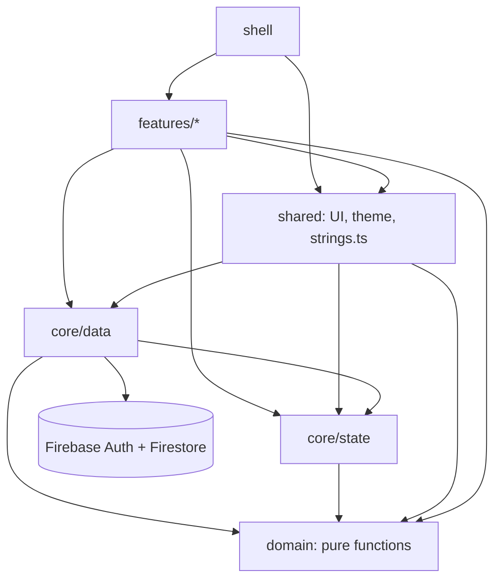
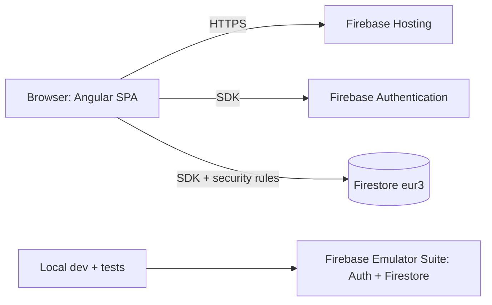
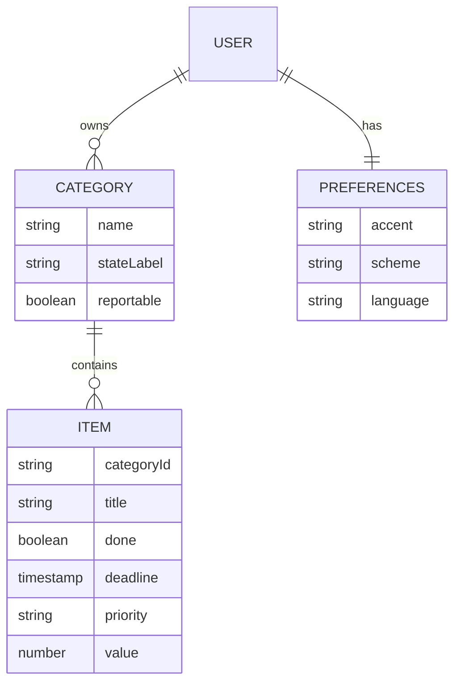

# Architecture Spine — MemoIt

## Design Paradigm

**Feature-sliced Angular single-page app with one data-access boundary, and no server code.** Feature folders own their screens; a pure `domain` owns every calculation; `core/data` is the only code that talks to Firebase; Firebase is used for persistence only.

| Layer | Directory | Owns |
| --- | --- | --- |
| Features | `src/app/features/{auth,categories,items,item-edit,category-settings,report,settings}` | Screens, feature-local components |
| Shell | `src/app/shell` | Navigation bar, rail and drawer, account menu, route table, guards |
| Domain | `src/app/domain` | Pure functions and types: `item`, `category`, `time`, `overdue`, `series`, `validation`, `number` |
| State | `src/app/core/state` | Firebase-free app state: `DraftStore`, `ClockService`, `ReminderService`, `LayoutService` |
| Data | `src/app/core/data` | `firebase.ts`, `AuthService`, `SessionScope`, `CategoryStore`, `ItemStore`, `PreferencesStore` |
| Shared UI | `src/app/shared` | `ItemFormComponent`, shared components, `theme.ts`, `strings.ts` |

Allowed imports (anything not listed is forbidden and enforced, AD-15):

| From | May import |
| --- | --- |
| `domain` | nothing outside `domain` |
| `core/state` | `domain` |
| `core/data` | `domain`, `core/state` |
| `shared` | `domain`, `core/*` |
| `features` | `domain`, `core/*`, `shared` |
| `shell` | `domain`, `core/*`, `shared`, `features` (routes only) |



`domain` imports nothing from Angular, Firebase or the DOM.

## Invariants & Rules

### AD-1 — One data boundary [ADOPTED]

- **Binds:** all, FR-2, NFR isolation
- **Prevents:** screens each calling Firestore their own way, so saves, errors and caching diverge.
- **Rule:** only files under `src/app/core/data/` may import `firebase/*` or `@firebase/*`. Everything else reads through the signals of `CategoryStore`, `ItemStore`, `PreferencesStore` and `AuthService` and writes through their methods. Enforced by ESLint `no-restricted-imports` (AD-15).

### AD-2 — Data model: two collections, items flat, full-document writes

- **Binds:** FR-3, FR-4, FR-5, FR-8, FR-11, FR-12
- **Prevents:** items under a subcollection forcing one read per Category; counters stored beside the data and drifting; one builder merging and another replacing; a missing value stored as `null` or `0`.
- **Rule:** Categories live at `users/{uid}/categories/{categoryId}` and Items at `users/{uid}/items/{itemId}` (auto ids), each Item carrying `categoryId`. Domain types in `domain/category.ts` and `domain/item.ts` are the only shapes that cross layers. Category fields: `name`, `stateLabel` (default "Done"), `reportable` (default false), `createdAt`, `updatedAt`. Item fields: `categoryId`, `title`, `description` (absent when empty), `done` (boolean), `deadline` (Firestore Timestamp, absent when none), `priority` (`low | medium | high`, default `medium`), `value` (number, absent when none), `createdAt`, `updatedAt`. An absent value is an absent field, never `null` or `0`. Each store alone owns `toDoc`/`fromDoc`. Writes are full documents by id (`setDoc` without `merge`), so retries are idempotent; `createdAt` is preserved on edit. Open-item counts, overdue, due-soon and Report data are derived in memory, never stored. Turning `reportable` off keeps stored `value`s.

### AD-3 — No server code, persistence only [ADOPTED]

- **Binds:** all, FR-9, PRD §6.3
- **Prevents:** a Cloud Function, scheduler or server endpoint appearing "just for reminders"; a billing plan change; logic outside the client and the rules.
- **Rule:** the project uses Firebase Authentication, Cloud Firestore and Firebase Hosting only. No Cloud Functions, no Cloud Tasks, no extensions, no other backend. All behavior is client code plus `firestore.rules`. Anything that needs a server (push, email) is deferred.

### AD-4 — One module owns time, deadlines and the clock

- **Binds:** FR-8, FR-9, FR-12, FR-13, UX overdue and due-soon
- **Prevents:** screens disagreeing on what overdue means; a stale "now" after midnight or sleep; `new Date` scattered; two date formatters; a deadline shown in the wrong zone.
- **Rule:** `domain/time.ts` exports `isOverdue(item, now)`, `isDueToday`, `isDueWithin(item, now, days)`, `weekStart`, `monthStart` and `formatDeadline(date, locale, style)`. A Deadline is a UTC instant (Firestore `Timestamp`) shown in the device's local time. `ClockService` is the only code that reads the clock: it exposes a `now` signal refreshed every 30 seconds and on tab visibility change. Overdue means `done === false` and `deadline < now`. Date construction and `Intl` date formatting happen only in `domain/time.ts` and `ClockService` (AD-15).

### AD-5 — Load once, mutate only through stores, confirm before showing (Done is optimistic)

- **Binds:** FR-3 to FR-8, FR-11, SM-1, SM-2
- **Prevents:** two caches of one Item; screens showing unsaved data as saved; a write that hangs forever when offline; inconsistent errors; a write landing in the wrong session.
- **Rule:** after a session exists, `CategoryStore` and `ItemStore` each load the user's whole collection once into a signal keyed by id, with `status` `loading | ready | error`. Lists, counts, Due soon and Report derive from those signals in memory. Mutations are only the store methods (`add`, `update`, `remove`, `toggleDone`, and `CategoryStore.remove`, AD-6); each returns `ok` or `error(code)` with `code` in `network | timeout | permission | invalid | unknown`. The signal updates only after a confirmed write, except `toggleDone`, which updates at once (single-tap Done with Undo) and rolls back with a visible error if the write fails; Undo is another `toggleDone`. Each write is raced against a 10 s timeout (offline writes would otherwise stay pending); on timeout the store reports `timeout`, rolls back, and before any next write to that document re-reads it with `getDocFromServer`. Every read and write carries the `sessionEpoch` current when it started and is discarded if it differs (AD-11). No realtime listeners and no Firestore offline persistence. Both stores reload when the tab becomes visible after more than 60 seconds `[ASSUMPTION]`. Two devices: last write wins.

### AD-6 — Category deletion cascades through the store; names are unique per User in the client

- **Binds:** FR-3, FR-4
- **Prevents:** orphan Items after a Category is deleted; a half-finished delete leaving the Category unusable; duplicate Category names.
- **Rule:** `CategoryStore.remove(id)` deletes the Category's Items first, in `writeBatch`es of at most 500, then the Category document; a failure midway leaves a Category with fewer Items and a retry finishes the job. It returns `ok` only after the Category document is gone, and then both signals are updated. Name uniqueness (case-insensitive, trimmed) is checked in `CategoryStore` only; Firestore rules cannot enforce it, and a two-device race may create a duplicate `[ASSUMPTION]`. "Clear Done Items" is `ItemStore.removeDone(categoryId)` with the same batching.

### AD-7 — In-app Reminders, derived from state; the data stays push-ready

- **Binds:** FR-9, UJ-3, SM-5
- **Prevents:** a reminder implementation that needs a backend; the same alert shown twice; alerts for Done or deleted Items; reminder fields baked into the model that v1 does not use.
- **Rule:** `ReminderService` (`core/state`) derives the set of open Items whose Deadline has arrived from `ItemStore` and the `now` signal (AD-4) and raises one in-app alert per `(itemId, deadlineMillis)`, remembered in `sessionStorage` so a reload does not repeat it. The alert opens that Item. Overdue Items are flagged on their row and counted on the Category list from the same derivation. The Item model has no reminder fields in v1 (no lead time, no "remind" flag); the Deadline is already a `Timestamp`, so push can be added later without migration (PRD §6.3).

### AD-8 — Report series: gaps are missing, never zero

- **Binds:** FR-11, FR-12, UJ-4
- **Prevents:** an empty week plotted as `0`; weekly and monthly views bucketing differently; charts with different axes; Chart.js code in two places.
- **Rule:** `domain/series.ts` builds the series for one Reportable Category: each Item with a `value` is placed at its Deadline, else its `createdAt`, in device-local time; buckets are weeks starting Monday or calendar months `[ASSUMPTION]`; a bucket's value is the sum of its Values; a bucket with no Values is absent from the series (a gap), never `0`. One helper in `features/report` turns a series into the Chart.js dataset with `spanGaps: true`. Chart.js and `ng2-charts` are loaded with the `/report` route (lazy). Chart colors read the theme tokens at render time (AD-12). A Category with no Values shows the empty state. The period filter (3 months, 6 months, 1 year, all; ending today) is applied before bucketing, using `domain/time.ts`. The summary (latest, change over the period, average, lowest) is computed in `domain/series.ts` from the Values in the period, gaps excluded. The chosen period and aggregation are view state (Conventions).

### AD-9 — All UI text lives in one typed dictionary [ADOPTED]

- **Binds:** FR-13, all surfaces
- **Prevents:** a label left in one Language; text hard-coded in a template, snackbar or dialog; Material built-in labels in the wrong Language.
- **Rule:** `src/app/shared/strings.ts` holds every label, message and Material built-in label (via the `*Intl` providers), typed so each key has both `it` and `en` (a missing one fails compilation); parameterised text is a function. The current Language is one signal owned by `PreferencesStore`, mapped to one locale (`it-IT`, `en-GB`). Default English. No literal UI text in templates or components, no translation library. Numbers format through `domain/number.ts`, dates through `domain/time.ts`.

### AD-10 — Security rules are the authority on access and shape [ADOPTED]

- **Binds:** FR-2, NFR isolation (Descriptions may hold credentials in clear text)
- **Prevents:** a client check being the only guard; one User reading another's data; malformed documents; an Item pointing at someone else's Category.
- **Rule:** `firestore.rules` allows an authenticated user to read and write only `users/{uid}/categories/{id}`, `users/{uid}/items/{id}` and `users/{uid}/preferences/app` where `uid == request.auth.uid`; every other path, and every unauthenticated request, is denied. Categories: keys are a subset of the AD-2 fields; `name` is a string of 1 to 60 characters, `stateLabel` 1 to 16, `reportable` a boolean; `updatedAt == request.time`; `createdAt` unchanged on update. Items: keys are a subset of the AD-2 fields; `title` 1 to 120 characters, `description` at most 4000, `done` boolean, `priority` in the three values, `deadline` a timestamp, `value` `is number` (not `is float`); `categoryId` must reference an existing Category of the same `uid` (`exists`); `updatedAt == request.time`; `createdAt` unchanged on update. `preferences/app`: `accent` is a preset id or `custom` with `hue` 0 to 360 and `chroma` 0 to 0.3, `scheme` in `light | dark | system`, `language` in `it | en`. Emulator tests (`@firebase/rules-unit-testing`) cover cross-user rejection, unauthenticated rejection and every field with valid and invalid vectors shared with the client validators (AD-16); they run before any feature that stores data ships.

### AD-11 — One session lifecycle [ADOPTED]

- **Binds:** FR-1, FR-2, UX account menu
- **Prevents:** a login redirect on every reload; data visible after logout; in-flight reads or writes leaking one account's data into the next; Sign out implemented per screen.
- **Rule:** `AuthService` exposes a tri-state session signal `unknown | signedOut | signedIn(uid)` and `signIn`/`signOut`. One route guard waits out `unknown`, then protects every route except `/login`. `SessionScope` is the only code that starts and resets the stores: on every session change it increments `sessionEpoch`, resets `CategoryStore`, `ItemStore`, `PreferencesStore`, `DraftStore` and the reminder memory to empty, clears device-local view state for the previous uid, and, when `signedIn`, loads the stores. Every read and write is tagged with its `sessionEpoch` and discarded if it differs. The shell's account menu and the rail/drawer entry both call `AuthService.signOut()` and nothing else, then route to `/login`. No registration and no password reset: accounts are created in the Firebase console. Auth failures return `auth-error(code)` with `code` in `invalid-credentials | invalid-email | network | unknown`, mapped to `strings.ts`.

### AD-12 — One accent drives the whole theme

- **Binds:** FR-14, DESIGN.md
- **Prevents:** color literals in components; an accent that fails contrast; light and dark derived differently; the accent leaking into error, priority or overdue colors.
- **Rule:** the Settings choice is one value: a preset id (the nine in DESIGN.md) or `custom` with `hue` and `chroma`, plus `scheme` (`light | dark | system`). `shared/theme.ts` is the only code that turns it into colors: a pure function maps accent and scheme to every Material 3 role using the OKLCH tonal formulas of `mockups/assets/m3.css`, and sets them as CSS custom properties (Angular Material `--mat-sys-*` tokens and the app's own role tokens) on `<html>`; `system` follows `prefers-color-scheme`. Components use tokens only. Error, overdue and High-priority colors derive from fixed roles, not from the accent hue (tertiary is accent +60°). A unit test computes AA contrast (4.5:1 text, 3:1 graphics) for the text and essential-graphic token pairs of every preset in both schemes and of sampled custom hues, and fails the build below that. `PreferencesStore` persists the choice in `users/{uid}/preferences/app` (full document), applies it immediately, rolls back with a visible error if the save fails, never lets a late load overwrite a later choice, and mirrors accent, scheme and Language to `localStorage` to avoid a flash on start. Defaults before load: indigo, `system`, English.

### AD-13 — Environments, release and operations [ADOPTED]

- **Binds:** FR-1, FR-2, all
- **Prevents:** development touching real data; configuration scattered in code; rules and app released out of step; irreversible project choices made by accident.
- **Rule:** two environments only. `local` uses the Firebase Emulator Suite (Auth and Firestore; needs a JDK 21 or newer); `prod` is the real Firebase project served by Firebase Hosting over HTTPS. Firebase config lives only in `src/environments/`; production values sit in a gitignored file with a committed example, and the production build fails without it. `firebase.ts` connects to the emulators only when the environment is `local`. The Firestore database is created in multi-region `eur3` (immutable location) `[ASSUMPTION: same as the reference project]`. Email-enumeration protection is enabled in Authentication settings. Release is `npm run deploy`: it runs `npm run check` (AD-15), stops on failure, then deploys rules first and Hosting second. Rollback: Hosting from its version history; rules by redeploying the previous `firestore.rules` from source control. The repository is under version control from the scaffold. No CI and no staging in v1.

### AD-14 — One Item form and one draft store [ADOPTED]

- **Binds:** FR-5, FR-8, FR-11, UX Item edit
- **Prevents:** "new item" and "edit item" disagreeing on defaults or validation; typed text lost on a failed save; the Value field appearing in the wrong Category.
- **Rule:** `shared/ItemFormComponent` is the only form for an Item, used by the routes `/c/:categoryId/i/new` and `/c/:categoryId/i/:itemId`, as a dialog or full screen by `windowClass`. A pure `initialDraft(categoryId, item?)` in `domain/item.ts` builds the draft: an existing Item keeps its stored values; a new one has Priority `medium`, no Deadline, and no Value. The Value field is rendered only when the Category's `reportable` is true. `DraftStore` (`core/state`) holds one draft per route target, dropped after a confirmed save, Cancel, delete or logout; typed values survive a failed save. Title is required; validation lives in `domain/validation.ts` and is shared with the rules tests.

### AD-15 — Rules that are mechanically enforced [ADOPTED]

- **Binds:** AD-1, AD-3, AD-4, AD-9, AD-16, Paradigm
- **Prevents:** an invariant that is documented but silently broken.
- **Rule:** `npm run check` runs ESLint, the unit tests and the rules tests, and is the only gate (it runs before every deploy, AD-13). It fails on: (a) any import that violates the allowed-imports table or imports `firebase/*` or `@firebase/*` outside `core/data`; (b) `new Date`, `Date.now`, `Date.parse` or `Intl.DateTimeFormat` outside `domain/time.ts` and `ClockService`, with an allowance for fake-clock setup in tests; (c) Angular or DOM imports inside `domain`; (d) `toFixed`, `toLocaleString` and `Intl.NumberFormat` outside `domain/number.ts`; (e) literal user-visible text in a template or in TypeScript passed to a snackbar, dialog or title, checked by a Vitest test that scans templates; (f) any `functions/` directory or Cloud Functions import (AD-3).

### AD-16 — Numbers

- **Binds:** FR-11, FR-13, AD-10
- **Prevents:** `82.4 + 0.1 = 82.50000000000001`; rules rejecting values the client saves; decimal comma stored differently from the point.
- **Rule:** `domain/number.ts` is the only place that parses and formats numbers. It accepts a decimal comma or point in either Language and rejects anything non-numeric (FR-11); decimals are allowed. Series sums use a single rounding rule defined there. One formatter per Language serves every screen and chart. Shared test vectors run against the client validators and the rules.

### AD-17 — Accessibility floor

- **Binds:** UX Accessibility Floor, FR-13
- **Prevents:** each feature inventing its own focus, announcement and motion behavior.
- **Rule:** `<html lang>` follows the Language signal. Motion is gated by `prefers-reduced-motion`. Item rows expose `aria-pressed`; snackbars and save outcomes use one polite `aria-live` region; dialogs and the account menu trap focus, close on Escape and restore focus to their trigger. Touch targets are at least 48 by 48 px and list rows 72 px. Navigation items carry `aria-current`. Every chart has a text or table alternative built from the same series. Verified with automated checks (axe in the Playwright suite).

### AD-18 — UX mockups are a composition reference, not source

- **Binds:** every feature with a screen, UX Reference
- **Prevents:** mockup HTML, CSS or JavaScript copied into the app and breaking AD-9, AD-12 and AD-15 (inline text, color literals, `innerHTML`, sample data); mockup-only features built because they are on screen; a builder choosing between the mockup and the spine.
- **Rule:** for each screen, the mockup named in the UX Reference table is the reference for layout, hierarchy, states and microcopy intent; the behavior is taken from `EXPERIENCE.md` and this spine, which win on conflict. Mockups are ported to Angular components, never imported or reused as files. Text goes into `strings.ts`, colors come from tokens, data comes from the stores. Sample data in the mockups (names, counts, dates, "Bob") is not content. A feature that appears in a mockup but not in the PRD is not built until the PRD or the UX spine adopts it. The mockups were aligned with the PRD on 2026-11-06 and show no such feature today.

## Consistency Conventions

| Concern | Convention |
| --- | --- |
| Naming | Files `kebab-case`, one standalone component per file `name.component.ts`; services `name.service.ts` or `name.store.ts`; selectors prefixed `memo-`. |
| Components | Standalone only, `OnPush`, state in signals; no NgModules; code is written zoneless-compatible. RxJS only where an API forces it. |
| Layout | `LayoutService` exposes one `windowClass` signal (`compact` under 768 px, `medium` 768–1199, `expanded` 1200 and up) that drives navigation (bar, rail, drawer) and the two-pane Items layout from 1024 px; no component measures the window itself. |
| Routes | One table in `shell`: `/login`, `/categories`, `/c/:categoryId` (Items), `/c/:categoryId/settings`, `/c/:categoryId/i/new`, `/c/:categoryId/i/:itemId`, `/report`, `/settings`. A guard redirects a malformed or unknown id to `/categories`. |
| Data & formats | Ids are Firestore auto ids; timestamps are Firestore timestamps; priority `low | medium | high`; Category and Item shapes only through `domain`. |
| Errors | Store methods return `ok` or `error(code)` from the closed sets in AD-5 and AD-11; features map codes to `strings.ts`; raw Firebase text is never shown. |
| State | Stores and `core/state` hold all cross-screen state; features hold only view state. |
| View state | Sort (FR-10), list filters and the Report period and aggregation are per device in `localStorage`, keyed by uid and Category `[ASSUMPTION]`; they never reach Firestore. |
| Performance | Chart.js is loaded with the Report route. Lists derive from the in-memory signals; the Done toggle must show in under 100 ms (AD-5). |
| Tests | Unit tests next to their file as `*.spec.ts` through `ng test` (Vitest); rules tests in `tests/rules/`; end-to-end in `e2e/`. |

## Stack

Verified against the npm registry on 2026-11-06.

| Name | Version |
| --- | --- |
| Node.js | >= 24.15.0 |
| JDK (Firebase Emulator) | >= 21 |
| Angular (core, common, forms, router, platform-browser, compiler) | 22.2.4 |
| Angular Material and CDK (CDK must equal Material) | 22.2.6 |
| Angular CLI and build | 22.2.6 |
| TypeScript (capped by the Angular 22 peer range `>=6.0 <6.1`; 7.0.2 exists but is not supported) | ~6.0.3 |
| RxJS | ~7.8.2 |
| zone.js (as scaffolded; code stays zoneless-compatible) | ~0.16.3 |
| firebase (JS SDK, modular) | 13.2.0 |
| chart.js | 4.6.1 |
| ng2-charts | 11.0.0 |
| Vitest | 5.1.0 |
| jsdom | 31.0.0 |
| @firebase/rules-unit-testing (peer `firebase ^13`) | 6.0.0 |
| firebase-tools | 15.35.0 |
| @playwright/test | 1.65.0 |
| ESLint, typescript-eslint, angular-eslint | 10.14.0, 8.72.1, 22.6.0; confirm each supports TypeScript 6.0 at scaffold |

`@angular/fire` is not used (its 22 line is still a release candidate).

## Structural Seed





```text
memoit/
  src/
    app/
      features/{auth,categories,items,item-edit,category-settings,report,settings}/
      shell/
      domain/            # item, category, time, overdue, series, validation, number (pure)
      core/state/        # draft.store.ts, clock.service.ts, reminder.service.ts, layout.service.ts
      core/data/         # firebase.ts, auth.service.ts, session-scope.ts, category.store.ts, item.store.ts, preferences.store.ts
      shared/            # item-form, ui components, theme.ts, strings.ts
    environments/
  tests/rules/           # emulator tests for firestore.rules
  e2e/                   # Playwright
  firestore.rules
  firebase.json
```

## Capability → Architecture Map

| Capability / Area | Lives in | Governed by |
| --- | --- | --- |
| FR-1 Login and logout | `features/auth`, `core/data/auth.service.ts`, `session-scope.ts`, shell account menu | AD-1, AD-11, AD-13 |
| FR-2 Per-user isolation | `firestore.rules`, `tests/rules` | AD-3, AD-10, AD-11 |
| FR-3 Create and choose a Category | `features/categories`, `core/data/category.store.ts` | AD-2, AD-5, AD-6 |
| FR-4 Category management | `features/category-settings`, `category.store.ts`, `item.store.ts` | AD-2, AD-5, AD-6 |
| FR-5 Add and edit an Item | `features/item-edit`, `shared/item-form`, `item.store.ts` | AD-2, AD-5, AD-14 |
| FR-6 Toggle Done, Undo | `features/items`, `item.store.ts` | AD-2, AD-5, AD-17 |
| FR-7 Delete an Item | `features/item-edit`, `item.store.ts` | AD-5, AD-10 |
| FR-8 Deadline and Priority | `shared/item-form`, `domain/time.ts` | AD-2, AD-4 |
| FR-9 In-app Reminders | `core/state/reminder.service.ts`, `clock.service.ts`, `features/items`, `features/categories` | AD-3, AD-4, AD-7 |
| FR-10 Sort (Should) | `features/items` | Conventions (view state) |
| FR-11 Enter a Value | `shared/item-form`, `domain/number.ts` | AD-2, AD-14, AD-16 |
| FR-12 Report | `features/report`, `domain/series.ts` | AD-4, AD-8, AD-12 |
| FR-13 Language | `features/settings`, `preferences.store.ts`, `shared/strings.ts` | AD-9 |
| FR-14 Theme and accent | `features/settings`, `preferences.store.ts`, `shared/theme.ts` | AD-12 |
| Shell, responsive navigation, two-pane Items | `shell`, `core/state/layout.service.ts` | Paradigm, Conventions (Layout), AD-17 |

## UX Reference

Mockups live in `_bmad-output/planning-artifacts/ux-designs/ux-bmad612_home-2026-11-06/mockups/`; open `index.html` for the gallery. Paths below are relative to that folder. AD-18 governs how they are used.

| Route | Screen | Mockup | Feature folder | Take from the mockup | Do not build (see AD-18) |
| --- | --- | --- | --- | --- | --- |
| `/login` | Sign in | `login.html` | `features/auth` | Split layout on expanded, tonal header on compact; password Show/Hide; sign-out confirmation snackbar | none; the language switch before sign-in is device-local only, not stored in Firestore `[ASSUMPTION]` |
| `/categories` | Home | `categories.html`, `categories.html?empty=1` | `features/categories` | Greeting, search, summary card (overdue, open, this week, categories), Due soon strip, Category cards with progress, empty state | none; every number derives from the stores (AD-2, AD-4, AD-7), no stored counters |
| `/c/:categoryId` | Items | `items.html` | `features/items` | Head card with progress ring, search, filter chips, Open and Done sections, sort sheet, Done snackbar with Undo (AD-5), two-pane from 1024 px | none |
| `/c/:categoryId/i/new`, `/c/:categoryId/i/:itemId` | Item edit | `item-edit.html`, `item-edit.html?new=1`, `item-edit.html?c=weight` | `features/item-edit`, `shared/item-form` | Panels (Details, Priority tiles, When with quick deadline chips, Category), live preview, Value panel for a Reportable Category, delete confirmation | none; the Category is read-only and an Item is never moved between Categories in v1 |
| `/c/:categoryId/settings` | Category settings | `category-settings.html` | `features/category-settings` | Name, Done label with suggestions and live preview, Reportable switch, at-a-glance panel, clear-done and delete confirmations (AD-6) | none |
| `/report` | Report | `report.html` | `features/report` | Summary card (latest, change, average, lowest), period chips, trend chart, weekly/monthly switch, link to the Category list (AD-8) | none (the period filter is FR-12) |
| `/settings` | Settings | `settings.html` | `features/settings` | Accent swatches, custom hue, appearance, language, live mini-app preview (AD-9, AD-12) | none (there are no notification settings: AD-3, AD-7) |
| shell | Navigation and account menu | `assets/app.js` (`renderNav`, `renderAccount`) | `shell` | Bar, rail, drawer by window class; avatar menu with Settings and Sign out, plus Sign out at the end of the rail and drawer (AD-11) | none |
| theme | Color roles | `assets/m3.css` | `shared/theme.ts` | The OKLCH tonal formulas that map one accent to every role, in light and dark (AD-12) | The CSS itself; the app derives tokens in code |

Screen-to-screen paths are in `NAVIGATION.md`.

## Deferred

- Push notifications and any server-side reminder delivery (web push, email): PRD §6.3; AD-3 forbids server code until this is decided, and the data model is already compatible (AD-7).
- Offline use (Firestore persistence): PRD §6.3; v1 requires a connection (AD-5).
- Installable PWA (PRD 4.7, Could): independent of Reminders now; revisit with offline.
- Encryption of Descriptions that hold credentials: rules and login are the only protection in v1 (PRD §6.2); client-side encryption with a passphrase is the likely path.
- Reminder lead time: decided no for v1; adding it would add a model field and a rules change.
- Other chart types: decided no for v1 (FR-12 is one line chart).
- TypeScript 7 and Angular 23 upgrades: wait for the Angular peer range.
- `@angular/fire`: not used; revisit when a stable release supports the Angular version in use.
- CI pipeline, staging environment, backup and monitoring: out of v1.
- Time-zone travel: a Deadline is an instant shown in local time; accepted behavior.
- Name-uniqueness race across two devices (AD-6) and last-write-wins (AD-5): accepted for a family-sized app.
- Mockup extras cut on 2026-11-06 and not part of v1: Notifications switch, "Remind me" with lead time, "Keep me signed in", moving an Item between Categories, the Report bar chart and entries list, the "Done today" counter. The data model and the rules do not carry them. Adopted instead: the Report period filter and summary (FR-12, AD-8).
