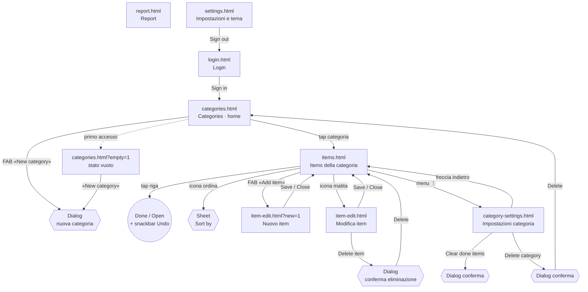
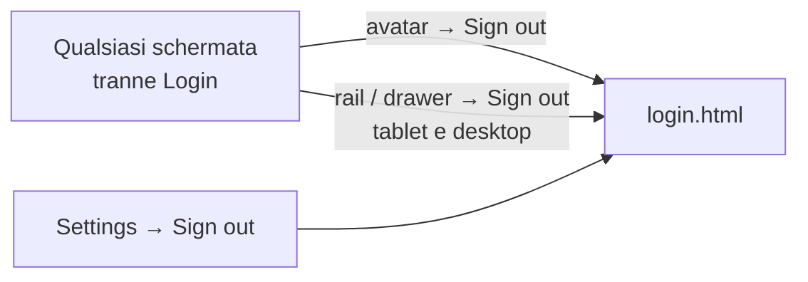

# MemoIt — Navigazione tra le schermate

Come si passa da una schermata all'altra. Le schermate sono i file HTML in `mockups/`. Apri `mockups/index.html` per vederle tutte insieme, oppure parti da `login.html`.

> I mockup sono file statici: usano solo HTML, CSS e un po' di JavaScript. Per vederli basta un browser. Se il browser blocca qualcosa aprendoli da disco, servili con `python -m http.server` dalla cartella `mockups/`.

## Mappa

Le tre destinazioni principali (**Categories**, **Report**, **Settings**) sono sempre raggiungibili dalla barra di navigazione, da qualsiasi schermata che non sia il login.

## Logout: da ogni schermata

Il **Sign out** non sta solo in Settings. Si fa da qualsiasi schermata tranne il login, in due modi:

1. **Menu account**: in ogni barra superiore c'è l'avatar tondo con l'iniziale (in alto a destra). Un tap apre un piccolo menu con nome ed email, **Settings** e **Sign out**. Si chiude con un tap fuori, con Esc o ridimensionando la finestra.
2. **Voce in fondo alla navigazione** su tablet e desktop: sotto Categories, Report e Settings, nella rail o nel drawer, c'è **Sign out**.

Il logout porta a `login.html` e mostra per qualche secondo «You have been signed out». Non chiede conferma: è reversibile, basta accedere di nuovo. Sul telefono la barra in basso resta a tre voci, e il logout passa dall'avatar.

## La barra di navigazione si adatta allo schermo

| Larghezza | Barra | Dove si trova |
|---|---|---|
| Telefono (< 768 px) | Bottom navigation bar con 3 voci | In basso |
| Tablet (768–1199 px) | Navigation rail (icone + etichetta) | A sinistra |
| Desktop (≥ 1200 px) | Navigation drawer con logo e nomi | A sinistra |

Su schermi da 1024 px in su la schermata **Items** diventa a due pannelli: a sinistra l'elenco delle categorie, a destra gli item. Si cambia categoria senza tornare indietro, e per questo il pulsante «indietro» sparisce.

## Schermate e percorsi

### 1. Login — `login.html`
- **Da dove**: apertura dell'app senza sessione, oppure *Sign out* in Settings.
- **Dove porta**: *Sign in* → Categories.
- Non c'è registrazione né recupero password: gli account li crea il proprietario.

### 2. Categories (home) — `categories.html`
- **Da dove**: login, barra di navigazione, *Delete category*.
- **Cosa c'è**: saluto, barra di ricerca (filtra le categorie mentre scrivi), riquadro riepilogo («2 items overdue», aperti, in scadenza questa settimana, numero di categorie), carosello **Due soon**, e le categorie come card con barra di avanzamento.
- **Dove porta**:
  - tap su una card di categoria o su una card di **Due soon** → Items di quella categoria;
  - FAB **New category** → dialog con il nome, poi la categoria compare in lista;
  - icona tavolozza → Settings;
  - avatar in alto a destra → menu account (Settings, Sign out).
- **Stato vuoto** (primo accesso di un familiare): `categories.html?empty=1`, con invito a creare la prima categoria.

### 3. Items — `items.html?c=<categoria>`
`c` può essere `grocery`, `books`, `car`, `weight` o `reading`.
- **Da dove**: tap su una categoria; *Save*, *Delete* o *Close* dalla schermata item; freccia indietro da Category settings.
- **Cosa si fa qui**:
  - in alto un riepilogo con l'avanzamento (anello con percentuale, aperti, fatti, quanti in ritardo);
  - **ricerca** nella categoria e **filtri** a chip: All, Overdue, High priority, Has deadline;
  - **tap su una riga**: segna l'item come *Done* (o lo riapre). Compare una snackbar con **Undo**. Gli item finiti vanno in fondo, barrati. L'avanzamento si aggiorna subito;
  - **icona ordina**: sheet con *Newest first*, *Priority*, *Deadline*;
  - **FAB Add item** → `item-edit.html?new=1`;
  - **icona matita** su una riga → `item-edit.html` per modificare;
  - **menu ⋮** → Category settings.
- Su telefono e tablet stretto la freccia in alto riporta a Categories.

### 4. Nuovo / Modifica item — `item-edit.html`
- **Da dove**: FAB *Add item* o matita su una riga.
- **Campi**, in card separate: titolo (obbligatorio) e descrizione; priorità come tre tile (Low/Medium/High); **When** con scorciatoie (Today, Tomorrow, Next week, No deadline), data e ora, con una nota che ricorda l'avviso in-app alla scadenza; categoria in sola lettura (un elemento non si sposta tra categorie). Il campo **Value** compare solo nelle categorie *Reportable*: prova `item-edit.html?c=weight`.
- **Anteprima live**: su desktop sta a destra e su telefono sotto; mostra la riga dell'item così com'è, e si aggiorna mentre scrivi.
- **Dove porta**: *Save*, *Close* → torna alla schermata precedente. *Delete item* apre una conferma, e se confermi torna a Items. In «nuovo item» il pulsante Delete non c'è.

### 5. Category settings — `category-settings.html?c=<categoria>`
- **Da dove**: menu ⋮ in Items.
- **Cosa si fa qui**: rinomina, etichetta *Done* (ad es. «Bought», «Read»), flag *Reportable*.
- **Zona pericolo**: *Clear done items* chiede conferma e resta nella schermata. *Delete category* chiede conferma e porta a Categories.
- **Dove porta**: freccia indietro → Items.

### 6. Report — `report.html`
- **Da dove**: barra di navigazione.
- Riquadro con l'ultimo valore, la variazione, la media e il minimo; filtri di periodo (3 mesi, 6 mesi, 1 anno, All); grafico a linee con aggregazione settimanale o mensile. Il link **Open Weight list** porta alla lista dei valori.
- Se nessuna categoria è Reportable, si vede lo stato vuoto (nel file è presente ma nascosto).

### 7. Settings e tema — `settings.html`
- **Da dove**: barra di navigazione o icona tavolozza in Categories.
- **Tema multicolore**:
  - **Accent**: 9 colori predefiniti più uno slider per un colore libero;
  - **Appearance**: Light, Dark o System;
  - l'anteprima si aggiorna subito, e la scelta si applica a tutte le schermate e resta salvata.
- **Language**: English o Italiano. Nei mockup la scelta si salva ma i testi non vengono tradotti.
- **Sign out** → Login.

## Elementi che non sono schermate

| Elemento | Dove compare | Come si chiude |
|---|---|---|
| Dialog «New category» | Categories | Cancel, Create |
| Sheet «Sort by» | Items | tap su una voce, tap fuori o Esc |
| Snackbar con Undo | Items (e altre conferme) | dopo 5 secondi o tap su Undo |
| Dialog di conferma (elimina item, svuota Done, elimina categoria) | Item edit, Category settings | Cancel o azione |

## Come cambiare accento

Apri `settings.html`, scegli un colore in **Accent** (o muovi lo slider **Custom hue**), poi apri le altre schermate: sono già ricolorate. L'accento e Light/Dark sono salvati nel browser con la chiave `memoit.theme`.
